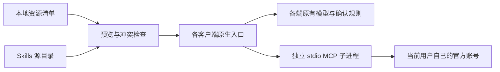

# Agent Shared Resources

[](https://github.com/Zhi-Chao-PAN/agent-shared-resources/actions/workflows/ci.yml)
[English overview](docs/README.en.md) · [平台与客户端](docs/compatibility.md) · [MCP 与授权](docs/mcp.md) · [架构与恢复](docs/design.md)

给同一台电脑上的多个 Agent 共用一份 Skills / MCP 资源清单，按客户端选择发布，保留各自的模型、插件和确认规则。

这是从一套实际使用过的 Mac 共享资源系统整理出的**独立、脱敏的开源实现**。使用 Node.js 22+，提供 macOS / Windows 的同一套 CLI。CI 测试文件适配与恢复机制；客户端里的真实模型调用、OAuth、浏览器和语言服务器仍需在你的机器上验收，不能用 CI 代替。

## 它做什么

- 一份技能源库，按客户端复制发布；Windows 不依赖管理员权限、符号链接或修改执行策略。
- MCP 只增删选中的独立条目，保留原配置、注释、模型、权限和其他服务器。
- `plan` 预览，`apply` 发布，`doctor` 检查文件，按客户端 / 资源 `rollback`。
- 同名不同内容直接拒绝覆盖；相同的既有资源不被认领，回滚也不会删除它们。
- 写入前记录事务，崩溃后可显式 `recover`；有并发修改就停止，避免整份配置回写。
- 默认不启用任何客户端，不登录账号，不改全局 Agent 指令，不部署验收 probe。

它不做账号共享服务、不同步聊天与记忆，也不保证模型每次都选某个工具。原生连接已经满足需求时，可以不加同类 MCP。Trae 等客户端继续使用自己的可见浏览器；Playwright 只是按需启用的隔离测试工具。



## 快速开始

先安装 [Node.js 22+](https://nodejs.org/en/download) 和 Git。以下操作在克隆目录执行。

macOS：

```sh
git clone https://github.com/Zhi-Chao-PAN/agent-shared-resources.git
cd agent-shared-resources
npm ci --ignore-scripts
node bin/ars.mjs init
node bin/ars.mjs select --client qoder-cn --skills shared-scientific-critical-thinking --mcp -
node bin/ars.mjs plan --client qoder-cn
node bin/ars.mjs apply --client qoder-cn
node bin/ars.mjs doctor --client qoder-cn
```

Windows PowerShell：

```powershell
git clone https://github.com/Zhi-Chao-PAN/agent-shared-resources.git
cd agent-shared-resources
npm.cmd ci --ignore-scripts
node bin/ars.mjs init
node bin/ars.mjs select --client qoder-cn --skills shared-scientific-critical-thinking --mcp -
node bin/ars.mjs plan --client qoder-cn
node bin/ars.mjs apply --client qoder-cn
node bin/ars.mjs doctor --client qoder-cn
```

`npm.cmd` 避免依赖 PowerShell 的脚本执行策略。这里不要求管理员权限，不设置执行策略，不使用 `curl | sh`。第一次只试点一个 Skill；在客户端新开任务，确认技能被实际发现并能加载正文。

客户端名可用 `node bin/ars.mjs clients` 查看。多个客户端时分别选择、预览和发布；不要把整份原生配置替换为别人的配置。

## 启用一个 MCP

可选运行时与管理器依赖分开安装。安装前自行规划缓存、浏览器等大文件的位置。

```sh
cd runtimes
npm ci --ignore-scripts
cd ..
node bin/ars.mjs select --client qoder-cn --mcp shared-context7
node bin/ars.mjs plan --client qoder-cn
node bin/ars.mjs apply --client qoder-cn
```

Windows 将上面的 `npm` 写成 `npm.cmd`。运行时依赖有单独锁文件；没有后台下载或安装钩子。Context7 可先做一次 React 库解析来验收。`doctor` 通过只表示文件与声明一致，**不表示模型已经调用成功**。

可选连接：Notion、Linear、GitHub、Context7、Exa、Playwright、Serena。自己的账号自己授权，不上传或复制他人的 token；GitHub / Serena / Playwright 另有前置依赖，见 [MCP 配置](docs/mcp.md)。原生工具、Skills 与 CLI 各有作用，不必一股脑全部启用。

## 本地配置

`init` 创建被 Git 忽略的 `agent-resources.local.json`。`select` 只改这份清单，`apply` 才改客户端入口。例如：

```json
{
  "version": 1,
  "clients": {
    "qoder-cn": {
      "skills": ["shared-scientific-critical-thinking"],
      "mcp": ["shared-context7"]
    }
  },
  "skills": {},
  "servers": {},
  "runtime": {}
}
```

资源列表使用逗号分隔；`-` 表示空列表。未提供的 `--skills` 或 `--mcp` 保持原选择。清空选择**不会自动卸载**已发布资源，要用明确的回滚命令。

自有或已审查的本地 Skill，可在 `skills` 中登记 `名称: 路径`。相对路径以本仓库为准；支持 `${root}`、`${home}` 和 `${node}` 占位符。`SKILL.md` 的 `name` 必须与登记名相同。

```json
"skills": {
  "my-skill": "${home}/my-reviewed-skills/my-skill"
}
```

可复用已有的 [飞书官方 CLI / Skills](https://github.com/larksuite/cli)，由使用者按官方指引安装并自行授权，再登记已安装的本地技能源。本仓库不附带个人飞书桥接、账号、通信目标或旧会议别名。自定义 stdio MCP 只接受 `command` / `args`；凭据放在官方登录态、系统环境或密钥存储，不放进共享清单。

## 回滚与更新

```sh
node bin/ars.mjs rollback --client qoder-cn --resource shared-context7
node bin/ars.mjs rollback --client qoder-cn --resource shared-scientific-critical-thinking
node bin/ars.mjs recover
```

回滚按回执只移除本工具创建、且仍与发布版本一致的入口，保留其他设置和后来新增的私有条目。备份与事务保存在当前用户的 `~/.agent-shared-resources/`，不在仓库里。回滚 Skill 的副本会移入该目录的备份区，原技能源不动。

首版要求在更换已发布的资源内容 / 启动参数之前先执行该资源的回滚，再发布新版本；不会自动覆盖用户修改过的副本。中断事务必须先 `recover`；并发编辑、来源变化或不完整暂存目录会停止恢复，详见 [恢复说明](docs/design.md)。

## 兼容与验收边界

已提供 10 个客户端的文件格式适配器。Qoder / Qoder CN、Codex、Gemini 使用文档中的用户目录入口；WorkBuddy、MiniMax、Trae CN、Antigravity、DSH、ZCode 的 Windows 路径必须由使用者明确确认后覆盖。MiniMax、DSH、ZCode 的 Skill 发现路径也必须显式填写，避免把文件放到一个不会被读取的目录。

Qoder 等客户端可能同时扫描 `~/.agents/skills`。扩展页显示的本地数量不一定等于模型实际可见数量。可用 Qoder 的原生 `hiddenSkills` 选择性隐藏本机旧入口，不删除公共目录；其他客户端的发现机制见 [兼容矩阵](docs/compatibility.md)。

原参考系统在 Mac 上验证过多个客户端的真实调用，但这些个人日志和账号信息不会公开。本仓库新 CLI 的自动化测试、公开运行时检查与参考系统实机经验分别记录在 [验证范围](docs/validation.md)。Windows CI 不等于 Windows 桌面客户端和官方登录都已逐端验证。

## 开发与来源

```sh
npm test
npm run check:publication
```

CI 在 macOS / Windows / Linux、Node 22 / 24 运行测试，不访问你的账号，不启动私有服务。发布检查扫描当前跟踪文件与提交历史中的常见凭据、本机路径和不应发布的文件。它不是完整安全审计。

自研管理器与文档采用 [MIT](LICENSE)。收录的四个第三方专项 Skills 保留原许可证、固定来源及内容哈希，见 [第三方声明](THIRD_PARTY_NOTICES.md) 与 [来源清单](catalog/skills.json)。MCP、CLI 和可选运行时遵循各自的许可证，本仓库不把它们重新授权为 MIT。
