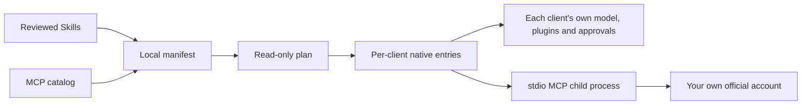

# Agent Shared Resources

**One reviewed library of Skills and MCP servers — published per agent, without overwriting what makes each client yours.**

[](https://github.com/Zhi-Chao-PAN/agent-shared-resources/actions/workflows/ci.yml)
[](https://nodejs.org)
[](#supported-clients)
[](LICENSE)

English · [简体中文](README.zh-CN.md)


The demo also publishes the optional Context7 MCP. The quick start below begins with one Skill and no runtime download.

If you use Claude Code, Codex, Gemini CLI, Qoder, Trae CN, or another coding agent on the same machine, you have probably copied the same Skill into several folders and hand-merged one more MCP server into JSON, TOML, or YAML. Then a client update moved a file, a symlink broke on Windows, or a copy script replaced a setting you needed.

This tool keeps **one reviewed source library** and publishes only the resources you select to each client's native location. It edits the target entry instead of replacing the whole config. Nothing is enabled by default.

## What it does

- **One library, many agents.** Select Skills and MCP servers per client from a single local manifest.
- **Surgical config edits.** JSON/JSONC keeps comments and unrelated keys; TOML/YAML gets a named, removable block. Your model, plugins, permissions, and private servers stay untouched.
- **Preview before writing.** `plan` is read-only. `apply` publishes. `doctor` verifies the files match the manifest.
- **Refuse rather than clobber.** A same-named entry with different content stops the whole publish; an identical pre-existing resource is left unowned.
- **Explicit rollback.** Receipts record only what this tool created, so rollback removes only unchanged, owned entries. Later private edits are preserved.
- **Crash-safe updates.** A prepared transaction is saved before writes; an interrupted run requires an explicit `recover`.
- **Cross-platform by design.** Copy-based publication needs no administrator rights, symlinks, or PowerShell execution-policy changes on Windows.
- **No hidden account or approval changes.** No automatic login, no global Agent instructions, no approval-rule edits, no model calls.



## Why not symlinks, dotfiles, or a copy script?

| Approach | Where it usually hurts | What this tool does instead |
|---|---|---|
| Symlink / junction | Windows privileges and permission differences; a broken link can make the client silently see nothing | Copies a complete Skill directory and verifies its content hash |
| Dotfiles / whole-file templates | Replaces the client's account, model, plugin, and permission state with someone else's file | Edits only the selected key or marked block and checks that everything else is semantically unchanged |
| Ad-hoc copy script | No conflict detection, no receipt, no safe rollback, and a half-finished run leaves mixed state | Plans the whole change set, refuses conflicts, writes transactionally, and rolls back by receipt |
| Manually editing every client | Drift between agents and no record of what was installed | One manifest, deterministic output per client, and `doctor` to detect drift |

Symlinks and dotfiles are still good tools. They are a poor fit when a client stores both shared resources and private state in the same file. See [the longer comparison](docs/comparison.md) for when each option is the better choice.

## Quick start

Requires [Node.js 22+](https://nodejs.org/en/download) and Git. Run these commands inside the checkout. Optional: run `npm link` once to use `ars` instead of `node bin/ars.mjs`.

macOS / Linux:

```sh
git clone https://github.com/Zhi-Chao-PAN/agent-shared-resources.git
cd agent-shared-resources
npm ci --ignore-scripts
node bin/ars.mjs init
node bin/ars.mjs resources
node bin/ars.mjs select --client claude --skills shared-scientific-critical-thinking --mcp -
node bin/ars.mjs plan --client claude
node bin/ars.mjs apply --client claude
node bin/ars.mjs doctor --client claude
```

Windows PowerShell:

```powershell
git clone https://github.com/Zhi-Chao-PAN/agent-shared-resources.git
cd agent-shared-resources
npm.cmd ci --ignore-scripts
node bin/ars.mjs init
node bin/ars.mjs resources
node bin/ars.mjs select --client claude --skills shared-scientific-critical-thinking --mcp -
node bin/ars.mjs plan --client claude
node bin/ars.mjs apply --client claude
node bin/ars.mjs doctor --client claude
```

`npm.cmd` avoids depending on PowerShell's script execution policy. Nothing here needs an elevated shell or a `curl | sh` install.

`plan` shows the complete change set before anything is written:

```json
{
  "ok": true,
  "changes": 1,
  "entries": [
    {"client": "claude", "resource": "shared-scientific-critical-thinking", "action": "copy"}
  ],
  "scope": "Files only; no server, account or model calls"
}
```

Replace `claude` with any id from `node bin/ars.mjs clients`. Repeat `select`, `plan`, `apply`, and `doctor` for each client — never paste another user's entire native config. For a multi-client walkthrough, see [the 5-minute quickstart](docs/quickstart.md).

> Claude Code uses **user scope only** (`~/.claude.json` and `~/.claude/skills`). Project-level `.mcp.json` and permission settings are not read or modified. The adapter follows the official paths; please [report your client version](https://github.com/Zhi-Chao-PAN/agent-shared-resources/issues/new?template=client_compatibility.yml) after a real discovery check.

### Add an MCP (optional)

MCP runtimes have their own lockfile and are installed separately. Do this only for the servers you selected:

```sh
cd runtimes
npm ci --ignore-scripts
cd ..
node bin/ars.mjs select --client claude --mcp shared-context7
node bin/ars.mjs plan --client claude
node bin/ars.mjs apply --client claude
```

On Windows, use `npm.cmd`. `doctor` checks the native declaration; it does not start the server, complete OAuth, or prove that a model called a tool. Verify that separately with one minimal read-only request.

## Supported clients

Eleven file-format adapters are covered by the test matrix. All clients start disabled.

| Client | id | MCP entry | Skills |
|---|---|---|---|
| Claude Code | `claude` | `~/.claude.json` → `mcpServers` | `~/.claude/skills` |
| Codex | `codex` | `~/.codex/config.toml` | `~/.codex/skills` |
| Qoder CN | `qoder-cn` | `~/.qoder-cn/settings.json` | `~/.qoder-cn/skills` |
| Qoder | `qoder` | `~/.qoder/settings.json` | `~/.qoder/skills` |
| Gemini CLI | `gemini` | `~/.gemini/settings.json` | `~/.gemini/skills` |
| WorkBuddy | `workbuddy` | `~/.workbuddy/mcp.json` | `~/.workbuddy/skills` |
| MiniMax | `minimax` | `~/.minimax/mcp.json` | explicit source required |
| Trae CN | `trae-cn` | `~/Library/Application Support/Trae CN/User/mcp.json` | `~/.trae-cn/skills` |
| Antigravity | `antigravity` | `~/.gemini/config/mcp_config.json` | `~/.gemini/config/skills` |
| DSH | `dsh` | `~/.dsh/profiles/desktop/cordis.patch.yml` | explicit root required |
| ZCode | `zcode` | `~/.zcode/cli/config.json` → `mcp.servers` | explicit root required |

These are **file-format defaults, not a promise that every version discovers them**. Windows paths for undocumented clients must be confirmed and set locally; the tool refuses to guess. See [compatibility and discovery](docs/compatibility.md).

## What is in the library

Four reviewed third-party Skills ship with their original licenses, pinned sources, and content hashes:

| Skill | Use it for |
|---|---|
| `shared-scientific-critical-thinking` | Evidence quality, experimental design, bias, and statistical interpretation |
| `shared-security-best-practices` | Language/framework security reviews (Python, JS/TS, Go) |
| `shared-mcp-builder` | Designing and evaluating MCP servers in Python or Node/TypeScript |
| `shared-frontend-design` | Distinctive UI direction, typography, and non-generic visual choices |

Seven optional MCP definitions:

| Resource | Authentication |
|---|---|
| `shared-notion`, `shared-linear` | Official hosted MCP; each user completes their own OAuth |
| `shared-context7`, `shared-exa` | Public endpoint with provider quotas; no limit bypass |
| `shared-github` | Your own `gh` login; token stays in the child process environment |
| `shared-playwright` | Optional isolated headless browser; not your everyday profile |
| `shared-serena` | Optional project tooling via `uvx`; no automatic indexing |

Run `node bin/ars.mjs resources` for descriptions and sources. MCP runtimes are installed separately in `runtimes/`; see [MCP setup](docs/mcp.md).

### Add your own reviewed Skill

Register a local source in `agent-resources.local.json`. Relative paths resolve from this repository; `${root}`, `${home}`, and `${node}` are supported. The `name` in `SKILL.md` must match the registered name.

```json
"skills": {
  "my-skill": "${home}/reviewed-skills/my-skill"
}
```

## One local manifest

`init` creates the Git-ignored `agent-resources.local.json`. `select` changes only this manifest; `apply` changes client files.

```json
{
  "version": 1,
  "clients": {
    "claude": {
      "skills": ["shared-scientific-critical-thinking"],
      "mcp": ["shared-context7"]
    },
    "codex": {
      "skills": ["shared-scientific-critical-thinking"],
      "mcp": []
    }
  },
  "skills": {},
  "servers": {},
  "runtime": {}
}
```

Lists are comma-separated on the command line; `-` clears a list. Omitting `--skills` or `--mcp` keeps the previous selection. **Clearing a selection does not uninstall anything** — use `rollback`.

Custom stdio servers accept only `command` and `args`. Keep credentials in the official login state, system environment, or keychain; never in the shared manifest.

## Update, rollback, recover

```sh
node bin/ars.mjs rollback --client claude --resource shared-context7
node bin/ars.mjs rollback --client claude --resource shared-scientific-critical-thinking
node bin/ars.mjs rollback --resource shared-scientific-critical-thinking
node bin/ars.mjs recover
```

To change a published Skill's content or an MCP launch command, roll back that resource first, then `apply` the new version. The tool will not overwrite a copy that you have edited.

- Rollback removes only entries created by this tool that still match the published content.
- Identical resources that already existed are never claimed or removed.
- Backups, receipts, pending transactions, and OAuth caches live in `~/.agent-shared-resources/`, outside the repository.
- A pending transaction blocks new publishes until `recover`; recovery stops if a native file was edited concurrently.

## Safety boundaries

What this tool deliberately does **not** do:

- log in to any account, store provider tokens in the manifest, or share credentials between users;
- change models, plugins, global Agent instructions, approval rules, or sandbox settings;
- replace a whole native config file or restore a backup over newer private edits;
- start MCP servers during `apply`, or run Skill scripts;
- sync chats, memories, or accounts between clients;
- guarantee that a model will choose a particular tool, or sandbox custom commands.

`doctor` proves the files and declarations match. It cannot prove that your client version reads that path or that a model actually calls the tool. After publishing, open a **new** client task and verify: the Skill is discovered, its body loads, and one minimal read-only MCP call succeeds. No business data is needed for acceptance.

## Development

```sh
npm test
npm run check
```

CI runs the tests on macOS, Windows, and Linux with Node.js 22 and 24. It never touches a real home directory, an account, or a private service. The publication check scans tracked files and Git history for common credential patterns, machine paths, and files that should not be published; it is a guardrail, not a complete security audit.

Client compatibility reports are especially welcome — they are how the honest support matrix grows. See [CONTRIBUTING.md](CONTRIBUTING.md) and the [compatibility report form](https://github.com/Zhi-Chao-PAN/agent-shared-resources/issues/new?template=client_compatibility.yml).

If this saves you from hand-merging one more agent config, **a star helps the next person find it.**

## License

The manager and documentation are [MIT](LICENSE). Bundled third-party Skills retain their original licenses; see [THIRD_PARTY_NOTICES.md](THIRD_PARTY_NOTICES.md) and the [source catalog](catalog/skills.json). MCP servers, CLIs, and optional runtimes keep their own licenses.
