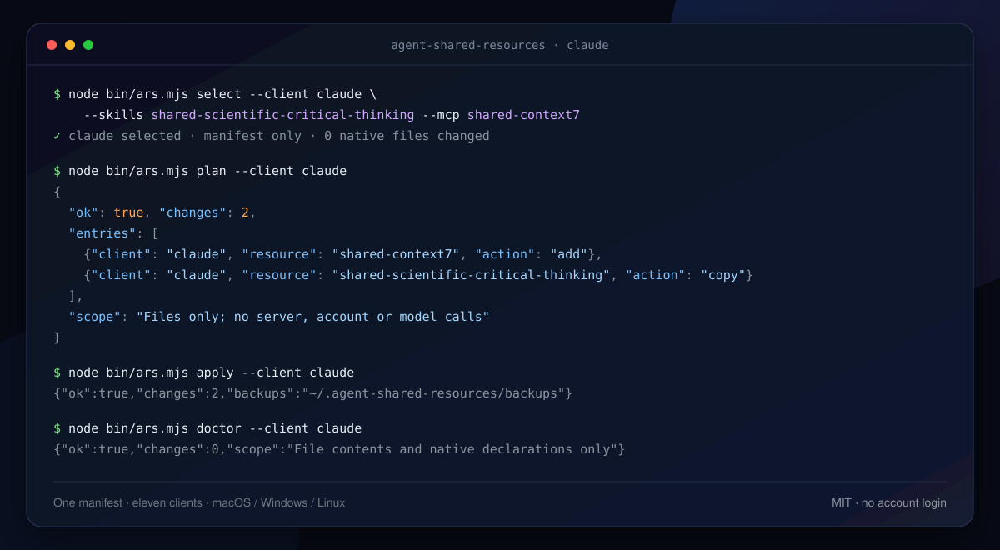
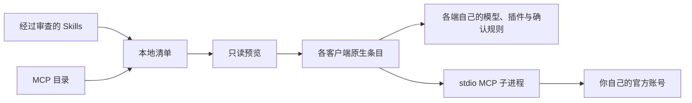

# Agent Shared Resources

**一份经过审查的 Skills / MCP 资源库，按客户端发布，不覆盖每个 Agent 各自的模型、插件与确认规则。**

[](https://github.com/Zhi-Chao-PAN/agent-shared-resources/actions/workflows/ci.yml)
[](https://nodejs.org)
[](#支持的客户端)
[](LICENSE)

[English](README.md) · 简体中文



演示里同时发布了可选的 Context7 MCP；下面的快速开始先只发布一个 Skill，不下载运行时。

如果你在同一台电脑上同时使用 Claude Code、Codex、Gemini CLI、Qoder、Trae CN 等 Agent，大概经历过这些事：同一个 Skill 复制到好几个目录；又往 JSON、TOML 或 YAML 里手工合并一个 MCP；客户端升级后路径变了；Windows 上符号链接失效；复制脚本把某个私有设置覆盖了。

这个工具只保留**一份经过审查的源库**，按客户端发布你选中的资源，并且只修改目标条目，不替换整份配置。默认不启用任何客户端。

## 它做什么

- **一份源库，多个 Agent。** 用一份本地清单为每个客户端选择 Skills 和 MCP。
- **精准修改配置。** JSON/JSONC 保留注释和无关键；TOML/YAML 写入有名称、可单独移除的受管块。模型、插件、权限和私有服务器保持原样。
- **先预览，再写入。** `plan` 只读；`apply` 发布；`doctor` 检查文件与清单是否一致。
- **冲突时拒绝，而不是覆盖。** 同名但内容不同的条目会让整次发布停止；内容相同的既有资源不会被认领。
- **明确回滚。** 回执只记录本工具创建的条目，回滚只移除仍与发布版本一致的部分；后来修改过的副本会保留。
- **中断可恢复。** 写入前保存完整事务；中断后必须显式 `recover`，不会盲写。
- **跨平台。** 复制发布；Windows 不需要管理员权限、符号链接或修改 PowerShell 执行策略。
- **不碰账号和审批。** 不自动登录、不改全局 Agent 指令、不改审批规则、不调用模型。



## 与符号链接、dotfiles、复制脚本的区别

| 方案 | 常见问题 | 这里的做法 |
|---|---|---|
| 符号链接 / junction | Windows 权限与目录差异；链接一断，客户端可能静默看不到技能 | 复制完整 Skill 目录并校验内容哈希 |
| Dotfiles / 整文件模板 | 容易把客户端的账号、模型、插件、权限状态替换成别人的文件 | 只改目标键或受管块，并检查其余语义状态未变 |
| 临时复制脚本 | 没有冲突检测、回执和安全回滚；中断后留下半套状态 | 整批预检、拒绝冲突、事务写入、按回执回滚 |
| 每个客户端手工改 | 各端逐渐漂移，也说不清装过什么 | 一份清单、确定性输出、`doctor` 检测漂移 |

符号链接和 dotfiles 本身没有问题；问题在于客户端常把“共享资源”和“私有状态”放在同一个文件里。各方案的适用场景见[更完整的比较](docs/comparison.md)。

## 快速开始

需要 [Node.js 22+](https://nodejs.org/en/download) 和 Git。以下命令在克隆目录执行。可选：执行一次 `npm link`，之后可用 `ars` 代替 `node bin/ars.mjs`。

macOS：

```sh
git clone https://github.com/Zhi-Chao-PAN/agent-shared-resources.git
cd agent-shared-resources
npm ci --ignore-scripts
node bin/ars.mjs init
node bin/ars.mjs resources
node bin/ars.mjs select --client claude --skills shared-scientific-critical-thinking --mcp -
node bin/ars.mjs plan --client claude
node bin/ars.mjs apply --client claude
node bin/ars.mjs doctor --client claude
```

Windows PowerShell：

```powershell
git clone https://github.com/Zhi-Chao-PAN/agent-shared-resources.git
cd agent-shared-resources
npm.cmd ci --ignore-scripts
node bin/ars.mjs init
node bin/ars.mjs resources
node bin/ars.mjs select --client claude --skills shared-scientific-critical-thinking --mcp -
node bin/ars.mjs plan --client claude
node bin/ars.mjs apply --client claude
node bin/ars.mjs doctor --client claude
```

`npm.cmd` 避免依赖 PowerShell 的脚本执行策略。这里不需要管理员权限，也不使用 `curl | sh`。

`plan` 会在写入前显示完整变更：

```json
{
  "ok": true,
  "changes": 1,
  "entries": [
    {"client": "claude", "resource": "shared-scientific-critical-thinking", "action": "copy"}
  ],
  "scope": "Files only; no server, account or model calls"
}
```

把 `claude` 换成 `node bin/ars.mjs clients` 里的任意 id。多个客户端就分别 `select`、`plan`、`apply`、`doctor`；不要把整份原生配置替换成别人的配置。更完整的三客户端流程见[英文快速教程](docs/quickstart.md)。

> Claude Code 只发布**用户级**配置：`~/.claude.json` 和 `~/.claude/skills`。项目级 `.mcp.json` 和权限设置不会被读取或改写。适配器按官方路径实现；真实发现验收后欢迎[提交客户端报告](https://github.com/Zhi-Chao-PAN/agent-shared-resources/issues/new?template=client_compatibility.yml)。

### 加一个 MCP（可选）

MCP 运行时使用独立锁文件，只为你选中的服务安装：

```sh
cd runtimes
npm ci --ignore-scripts
cd ..
node bin/ars.mjs select --client claude --mcp shared-context7
node bin/ars.mjs plan --client claude
node bin/ars.mjs apply --client claude
```

Windows 将 `npm` 写成 `npm.cmd`。`doctor` 只检查原生声明，不会启动服务、完成 OAuth 或证明模型调用了工具；这些需要单独做一次最小只读验收。

## 支持的客户端

测试矩阵覆盖十一种文件格式适配器。所有客户端默认关闭。

| 客户端 | id | MCP 入口 | Skills |
|---|---|---|---|
| Claude Code | `claude` | `~/.claude.json` → `mcpServers` | `~/.claude/skills` |
| Codex | `codex` | `~/.codex/config.toml` | `~/.codex/skills` |
| Qoder CN | `qoder-cn` | `~/.qoder-cn/settings.json` | `~/.qoder-cn/skills` |
| Qoder | `qoder` | `~/.qoder/settings.json` | `~/.qoder/skills` |
| Gemini CLI | `gemini` | `~/.gemini/settings.json` | `~/.gemini/skills` |
| WorkBuddy | `workbuddy` | `~/.workbuddy/mcp.json` | `~/.workbuddy/skills` |
| MiniMax | `minimax` | `~/.minimax/mcp.json` | 需显式填写技能源 |
| Trae CN | `trae-cn` | `~/Library/Application Support/Trae CN/User/mcp.json` | `~/.trae-cn/skills` |
| Antigravity | `antigravity` | `~/.gemini/config/mcp_config.json` | `~/.gemini/config/skills` |
| DSH | `dsh` | `~/.dsh/profiles/desktop/cordis.patch.yml` | 需显式填写发现根 |
| ZCode | `zcode` | `~/.zcode/cli/config.json` → `mcp.servers` | 需显式填写发现根 |

这些是**文件格式默认值，不代表每个版本都已完成真实模型验收**。未确认的 Windows 路径必须由使用者填写；工具拒绝猜测。详见[平台与客户端](docs/compatibility.md)。

## 资源库

四个带原许可证、固定来源和内容哈希的第三方 Skill：

| Skill | 用途 |
|---|---|
| `shared-scientific-critical-thinking` | 证据质量、实验设计、偏差与统计解释 |
| `shared-security-best-practices` | Python / JS-TS / Go 的安全审查 |
| `shared-mcp-builder` | Python 或 Node/TypeScript 的 MCP 设计与评估 |
| `shared-frontend-design` | 有辨识度的 UI 方向、字体与视觉选择 |

七个可选 MCP：

| 资源 | 授权方式 |
|---|---|
| `shared-notion`、`shared-linear` | 官方 hosted MCP，使用者各自完成 OAuth |
| `shared-context7`、`shared-exa` | 公共服务额度；不做绕过 |
| `shared-github` | 复用你自己的 `gh` 登录；token 只进子进程环境 |
| `shared-playwright` | 可选的隔离无头浏览器，不读取日常 profile |
| `shared-serena` | 可选的项目工具，经 `uvx` 启动，不自动索引 |

运行 `node bin/ars.mjs resources` 可查看描述与来源。MCP 运行时需在 `runtimes/` 单独安装，见 [MCP 与授权](docs/mcp.md)。

### 登记自己的 Skill

在 `agent-resources.local.json` 登记本地技能源。相对路径以本仓库为准，支持 `${root}`、`${home}`、`${node}`；`SKILL.md` 的 `name` 必须与登记名一致。

```json
"skills": {
  "my-skill": "${home}/reviewed-skills/my-skill"
}
```

## 本地配置

`init` 创建被 Git 忽略的 `agent-resources.local.json`。`select` 只改这份清单，`apply` 才改客户端入口。

```json
{
  "version": 1,
  "clients": {
    "claude": {
      "skills": ["shared-scientific-critical-thinking"],
      "mcp": ["shared-context7"]
    },
    "codex": {
      "skills": ["shared-scientific-critical-thinking"],
      "mcp": []
    }
  },
  "skills": {},
  "servers": {},
  "runtime": {}
}
```

命令行中的资源列表用逗号分隔，`-` 表示空列表。未提供的 `--skills` 或 `--mcp` 保持原选择。**清空选择不会自动卸载**，要用明确的回滚命令。

自定义 stdio MCP 只接受 `command` / `args`。凭据放在官方登录态、系统环境或密钥存储，不放进共享清单。

## 更新、回滚与恢复

```sh
node bin/ars.mjs rollback --client claude --resource shared-context7
node bin/ars.mjs rollback --client claude --resource shared-scientific-critical-thinking
node bin/ars.mjs rollback --resource shared-scientific-critical-thinking
node bin/ars.mjs recover
```

更换已发布资源的内容或启动参数前，先对该资源 `rollback`，再 `apply` 新版本；不会自动覆盖你修改过的副本。

- 回滚只移除本工具创建、且仍与发布内容一致的条目。
- 内容相同的既有资源不会被认领，也不会被删除。
- 备份、回执、待完成事务和 OAuth 缓存保存在 `~/.agent-shared-resources/`，不在仓库里。
- 存在待完成事务时，新的发布会被阻止；原生文件被并发修改时，恢复会停止并保留现场。

## 安全边界

这个工具**不做**以下事情：

- 代替你登录、在清单里保存 token，或在用户之间共享凭据；
- 修改模型、插件、全局 Agent 指令、审批规则或沙箱设置；
- 替换整份原生配置，或用备份覆盖后来新增的私有修改；
- 在 `apply` 时启动 MCP 服务，或执行 Skill 里的脚本；
- 同步聊天、记忆或账号；
- 保证模型一定调用某个工具，或为自定义命令提供沙箱。

`doctor` 只证明文件与声明一致，不能证明你的客户端版本会读取该路径，也不能证明模型真的调用了工具。发布后请新开一个客户端任务，确认技能被发现、正文能加载，并执行一次最小只读 MCP 调用；验收不需要创建业务数据。

## 开发与贡献

```sh
npm test
npm run check
```

CI 在 macOS / Windows / Linux、Node 22 / 24 上运行，不访问真实 home、账号或私有服务。发布检查会扫描跟踪文件和 Git 历史中的常见凭据、机器路径和不应发布的文件；它是护栏，不是完整安全审计。

欢迎提交真实的客户端兼容性报告——这是支持矩阵保持诚实的方式。见 [CONTRIBUTING.md](CONTRIBUTING.md) 和[兼容性报告模板](https://github.com/Zhi-Chao-PAN/agent-shared-resources/issues/new?template=client_compatibility.yml)。

如果它帮你少手工合并了一次 Agent 配置，**点一个 star，能让下一个遇到同样问题的人找到它。**

## 许可证

管理器与文档采用 [MIT](LICENSE)。收录的第三方 Skills 保留原许可证，见[第三方声明](THIRD_PARTY_NOTICES.md)与[来源清单](catalog/skills.json)。MCP、CLI 和可选运行时遵循各自的许可证。
